# Egypt 3D: a real-time interactive simulation

Egypt 3D is a browser-based real-time 3D model of Egypt, built with Three.js, TypeScript and Vite. It covers:

- all 27 governorates;
- 54 urban districts generated procedurally;
- 46 landmarks;
- real elevation data for the whole country, the Nile and the canals;
- a physically based sky with weather and a day/night cycle that follows Cairo time.

You can fly continuously from a view of the whole country, 1,500 km up, down to street level in Islamic Cairo.

| | | |
|---|---|---|
| 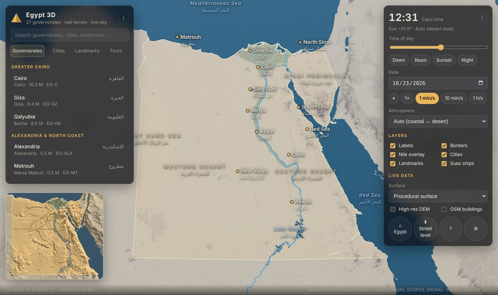 | 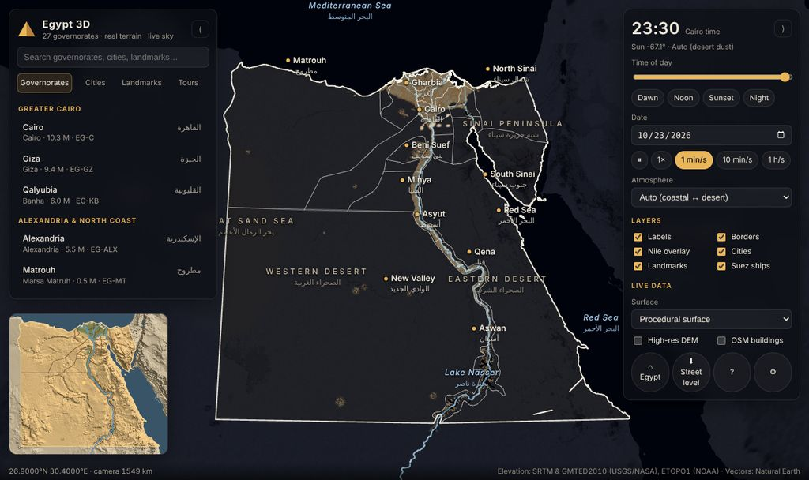 | 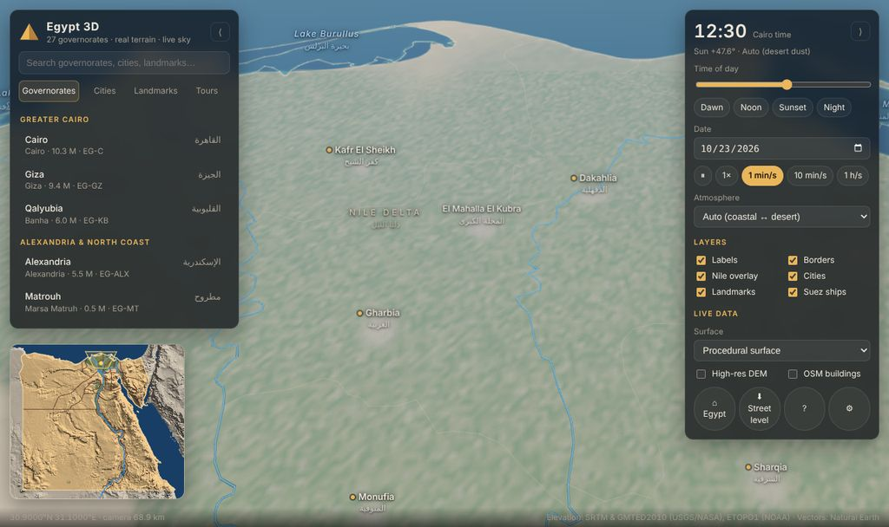 |
| Macro view, 1,550 km up, with governorate borders | The same view at night, with city lights | The Nile Delta from 70 km |
| 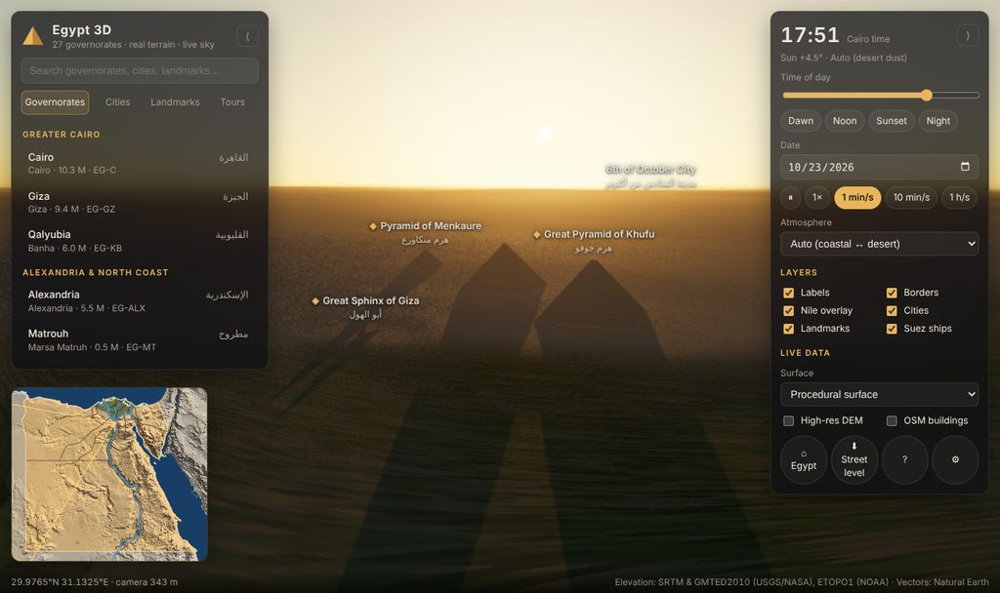 | 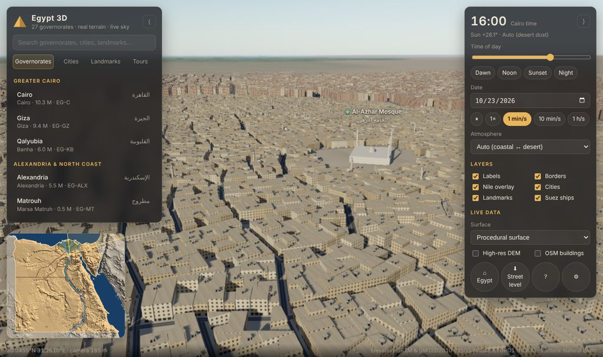 | 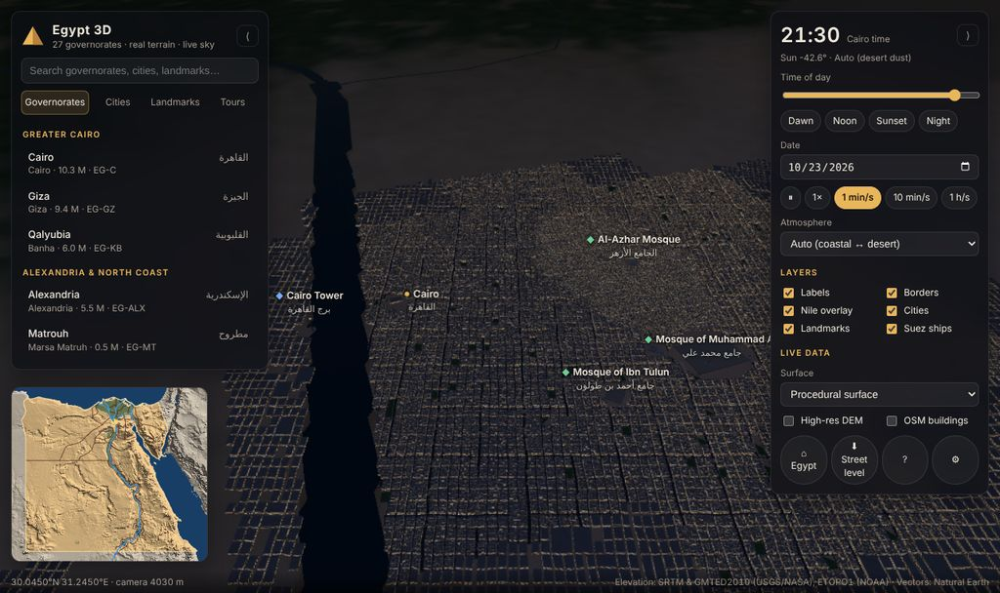 |
| Giza at sunset, with long pyramid shadows | Islamic Cairo at street level, with Al-Azhar | Downtown Cairo and the Nile at dusk |
| 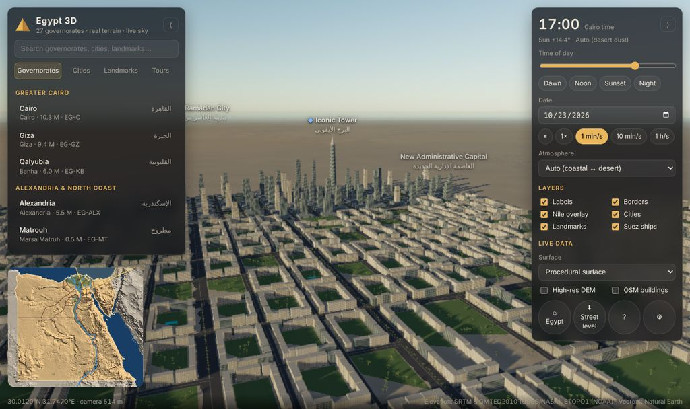 | 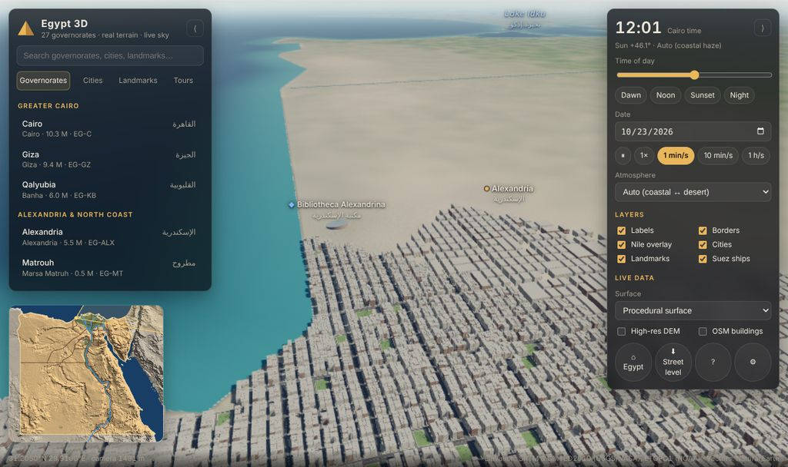 | 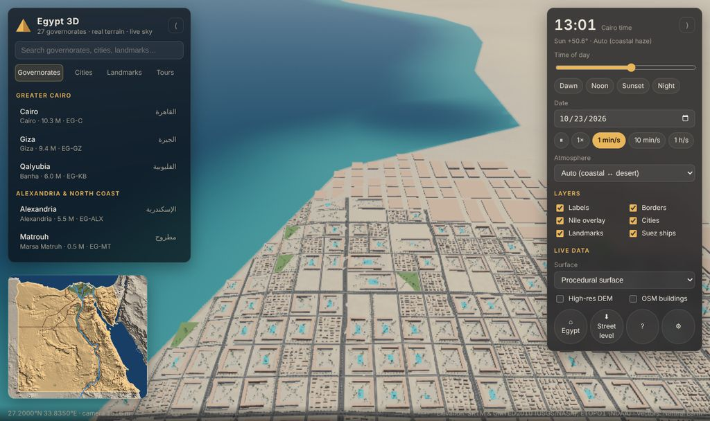 |
| New Administrative Capital: towers, CBD and parks | Alexandria in coastal haze | Hurghada resorts, with pools |
| 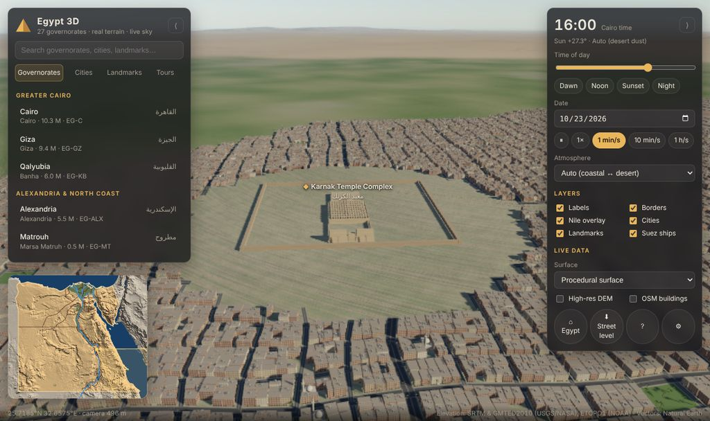 | 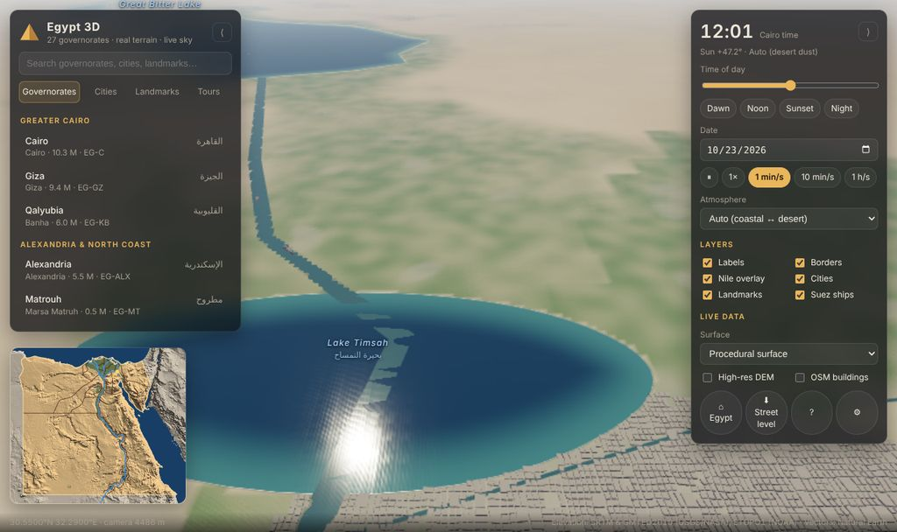 | 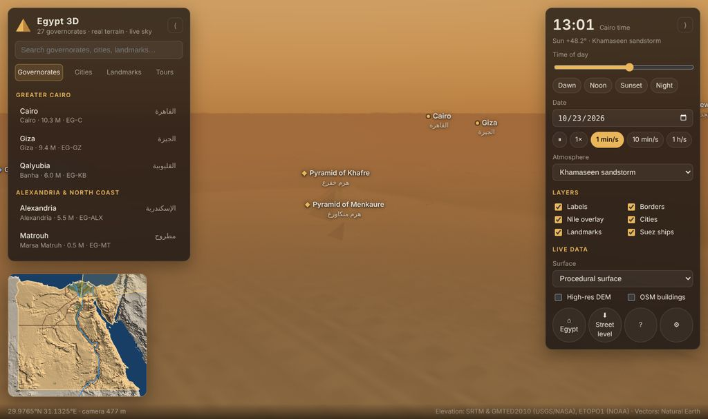 |
| Karnak temple complex, Luxor | Suez Canal and Lake Timsah, with convoys | A khamaseen sandstorm over Giza |

## Quick start

```bash
cd egypt-sim
npm ci
npm run dev            # http://localhost:5173
```

| Script | What it does |
|---|---|
| `npm run dev` | Starts the Vite dev server with hot reload |
| `npm run build` | Type-checks, then writes a static production build to `dist/` (relative paths, so it can be hosted anywhere) |
| `npm run preview` | Serves `dist/` locally |
| `npm test` | Runs the vitest suite. It runs headless against the real baked data, with no GPU needed |
| `npm run typecheck` | Runs `tsc --noEmit` |
| `npm run bake:gis` | Regenerates `public/data/*` from Natural Earth and AWS Terrain Tiles (see [Data pipeline](#data-pipeline)) |
| `npm run fetch:osm` | Downloads OpenStreetMap extracts for offline use |

Requirements:

- **Node 20.19+** (or 22.12+). `fetch:osm` needs Node 22.18+ because it imports TypeScript directly.
- **A browser with WebGL2.**

The app runs fully offline from the baked data in `public/data/` (about 2 MB). The live sources (imagery, high-resolution DEM, OSM) are optional toggles.

### Controls

| Input | Action |
|---|---|
| Drag | Pan (the ground stays under the cursor) |
| Right-drag, or Ctrl/Shift-drag | Rotate and tilt |
| Mouse wheel or pinch | Zoom toward the cursor |
| Double-click | Fly closer to that point |
| `W A S D` / arrow keys | Move |
| `Q`/`E`, `R`/`F` | Rotate, tilt |
| `+` / `−` | Zoom |
| `Home` | Fly back to the whole country |
| `` ` `` | Show performance stats |
| `?` | Show help |

To fly somewhere, click any label, list entry or search result, or click the minimap. The **Street level** button flies down to the ground at the current target. **Tours** offers four guided flights: the Nile, Cairo, the Suez Canal, and the two seas.

The view is stored in the URL, so links can be shared:

```
#v=<lat>,<lon>,<distance m>,<heading °>,<pitch °>&t=<UTC ISO time>&weather=<auto|clear|coastal|desert|khamaseen>
```

For example, `#v=29.9765,31.1325,1800,250,10&t=2026-10-23T14:50` gives Giza at sunset. That is 14:50 UTC, which is 17:50 Cairo summer time.

## The five capabilities

### 1. GIS and map data

The goal is real data with an accurate terrain mesh, at a size a browser can handle.

**Vectors.** Natural Earth 1:10m provides:

- land, the Egyptian border and the 27 governorates (ISO 3166-2);
- rivers (the Nile, its two Delta branches, the Suez and Ismailia canals);
- lakes (Nasser and the Great Bitter Lake).

Only Lake Nasser and the Great Bitter Lake come from Natural Earth. The bake tool adds the other lakes as hand-traced outlines: Qarun, Timsah, Manzala, Burullus, Idku, Mariout and Bardawil. It also adds the Mahmoudiya Canal. It then chains and smooths everything and serialises it to `egypt-gis.json` (190 KB).

**Elevation.** The source is AWS Terrain Tiles (Terrarium), which merges SRTM, GMTED2010 and ETOPO1. The bake produces two grids:

| Grid | Resolution | Extent |
|---|---|---|
| National | 0.01° (≈1.1 km) | Egypt |
| Context | 0.05° | 10.5–51°E, 11.5–42°N, so the horizon from orbit is real terrain and seabed rather than a void |

Both grids are stored as gzipped row-delta Int16 values (`EGDEM1`, 1.9 MB in total). An alternative pipeline uses USGS SRTM data through GDAL (`tools/build-dem.sh`).

**Projection.** The model uses a spherical Transverse Mercator projection centred on 30.8°E, 26.8°N. The world frame is metric, with X pointing east and Z pointing south. Scale distortion stays under 0.5% anywhere in Egypt. Scale-aware code reads the scale factor from `GeoProjection`.

**Terrain model.** `src/gis/terrainModel.ts` defines a single function, `sample(x, z, spacing)`. Every system calls it: terrain workers, city generation, the camera, labels and raycasts. It combines:

- bicubic interpolation of the DEM;
- procedural detail that is band-limited by the requested vertex spacing, so coarse levels never alias;
- seif dunes in the sand seas;
- river channels carved to the measured water surface;
- graded banks and beaches;
- flat building pads for landmarks;
- surface classes: fertility, urban, rock and sand.

**Water.** `src/gis/hydrography.ts` answers "what water is here, how far away is its shore, and what is its surface level". It works on exact vector geometry, using `SegmentGrid` and `RingIndex` from `src/core/spatialIndex.ts`. The lon/lat distance rasters only serve as an early-out.

**Live sources.** All three are optional toggles in the UI under *Live data*:

- *Satellite imagery*: Esri World Imagery or EOX Sentinel-2 cloudless. Near and far 4×4 tile mosaics are reprojected and blended into the terrain shader (`src/terrain/ImageryManager.ts`).
- *High-resolution DEM*: Terrarium tiles at the zoom level that matches each node's vertex spacing, up to z14 (SRTM 1″, about 30 m). They are decoded in the workers for every terrain node finer than 700 m spacing (`src/gis/liveDem.ts`).
- *OSM buildings*: Overpass footprints and roads for detail-level city tiles, with real heights from `height=` and `building:levels=` tags (`src/gis/osm.ts`). The client sends one request at a time, at least 1.1 s apart, with endpoint failover and caching. After three failures it falls back to procedural buildings.

### 2. Procedural city generation

Code: `src/city/`. Each urban district in `src/data/cities.json` is an oriented ellipse with a **profile**. The seven profiles are:

| Profile | Character | Example |
|---|---|---|
| `megacity` | Dense mid-rise concrete and brick blocks, rooftop water tanks | Cairo, Giza, Heliopolis |
| `historic` | Narrow warped lanes, perimeter blocks, domes and minarets | Islamic Cairo, Old Cairo, old Alexandria, Siwa |
| `modern` | Wide boulevards, villas, compounds and green lots | New Cairo, New Administrative Capital, 6th of October, New Alamein |
| `cbd` | Glass towers on large plots | NAC Central Business District |
| `coastal` | Mediterranean perimeter blocks, pale plaster, corniche | Alexandria, Port Said, Arish, Marsa Matruh |
| `resort` | Low resort blocks, pools and palms on the shoreline | Hurghada, El Gouna, Sharm el-Sheikh, Dahab |
| `provincial` | Low-rise towns in the Nile Valley, Delta and oases | Tanta, Mansoura, Asyut, Luxor, Aswan, Kharga |

`CityGenerator` builds deterministic 1 km tiles, so the same input always produces the same tile. Each tile goes through these steps:

1. A warped street grid is laid out per district, rotated to the district's grid bearing.
2. Neighbouring blocks merge into 2×2 superblocks.
3. Streets are inset per edge, with avenue widths.
4. Each block is filled with one of four lot layouts: recursive subdivision, a perimeter courtyard, towers in a plaza, or a resort strip.
5. Buildings follow the terrain. Plots are dropped where they would hit water or a landmark's clear zone.
6. Ownership between overlapping districts is resolved by centroid and priority, so district edges never double-build.

There are two levels of detail:

- **LOD 0** has individual buildings with roof clutter (stair huts, water tanks), neighbourhood mosques with domes and minarets, street ribbons, palms and street lamps.
- **LOD 1** has one extrusion per block.

A single facade shader handles every building. It draws procedural windows and floor lines, and lights windows at night for eight material styles. Window detail is averaged out once it falls below a pixel, so distant blocks do not shimmer.

### 3. Landmarks

Code: `src/data/landmarks.json` and `src/landmarks/`. There are 46 landmarks, each a validated JSON record:

```json
{
  "id": "khufu", "name": "Great Pyramid of Khufu", "nameAr": "هرم خوفو",
  "governorate": "EG-GZ", "category": "ancient",
  "lat": 29.97917, "lon": 31.13417, "headingDeg": 0, "clearRadius": 650,
  "model": { "type": "pyramid", "base": 230.3, "height": 138.5, "topWidth": 10 },
  "camera": { "distance": 1500, "pitchDeg": 16, "headingDeg": 35 },
  "description": "Built c. 2560 BC; the last surviving Wonder of the Ancient World. …"
}
```

`model` is a typed union of 22 parametric generators (`src/landmarks/models.ts`):

- **Ancient**: pyramid, bent pyramid, step pyramid, sphinx, temple, terrace temple, rock temple, colossi, obelisk, column.
- **Medieval and modern**: mosque, courtyard mosque, fortress, tower, skyscraper, disc, wedge, building.
- **Infrastructure**: dam, bridge, lighthouse.

Each landmark becomes a `THREE.LOD`: full detail near the camera, simplified massing beyond a few hundred metres, and nothing at long range, where its label takes over. Its `clearRadius` flattens the terrain and keeps procedural buildings away.

Highlights include:

- the Giza plateau: the three pyramids and the Sphinx, at true sizes and orientations, plus the Grand Egyptian Museum;
- Saqqara, Dahshur and Meidum;
- Karnak and Luxor temples, the Avenue of Sphinxes (instanced), the Valley of the Kings, Hatshepsut's temple and the Colossi of Memnon;
- Dendera, Abydos, Edfu, Kom Ombo, Philae and both Abu Simbel temples;
- the Citadel, the Muhammad Ali mosque, Sultan Hassan, Ibn Tulun and Al-Azhar;
- the Cairo Tower, the Egyptian Museum and the Iconic Tower;
- Alexandria's Bibliotheca, Qaitbay Citadel and Pompey's Pillar;
- the High Dam, the old Aswan Dam, the Suez Canal Bridge and the Port Said lighthouse;
- Saint Catherine's Monastery, Mount Sinai, Siwa's Shali fortress, the White Desert, the Qattara Depression and Gilf Kebir.

Linear features are geometry, not points:

- The Nile and the canals are carved channels plus vector water ribbons (`WaterRibbons.ts`).
- Ship convoys move along the Suez Canal (`SuezTraffic.ts`).
- Map overlays draw borders and waterways from orbit (`MapOverlays.ts`).

When a landmark position comes from a generalised source, the record carries `approx: true`. `npm test` checks every landmark for two things: it lies on land, and it sits inside its stated governorate.

### 4. Environment and atmosphere

Code: `src/environment/`.

**Sun, moon and time.** The sun and moon follow the NOAA solar-position algorithm for the camera target's longitude and latitude. Time is Cairo local time, including Egypt's daylight-saving rule (last Friday of April to last Thursday of October). Time can run at 1×, 1 min/s, 10 min/s or 1 h/s, or be scrubbed with the slider.

**Sky.** A Nishita single-scattering sky with Rayleigh and Mie scattering. It takes 24 samples on a quadratic distribution along the view ray and 8 toward the sun. It is correct from street level up to orbit, including sunset colour and the Earth's shadow, and it draws stars at night.

**Aerial perspective.** The same scattering model is injected into the terrain, city, landmark and water shaders. It uses analytic exponential optical depth, so the haze is consistent with the sky at any altitude.

**Weather.** Weather presets change aerosol density, scale height, tint and phase function:

| Preset | Description |
|---|---|
| `clear` | Clean air |
| `coastal` | Humid haze along the coasts |
| `desert` | Dust haze inland |
| `khamaseen` | A spring sandstorm: dense, orange, multiple-scattering dust |

`auto` blends coastal and desert haze by distance from the coast.

**Lighting.** It includes:

- sun shadows near the ground, from a 2048² shadow map fitted to the view;
- moonlight and hemisphere sky light;
- exposure that adapts from noon to night;
- sea, lake and river shading with Fresnel sky reflection, waves and shore foam;
- night lighting: lit windows (switching on through the evening), sodium street lamps and urban glow on the terrain. From orbit the glow aggregates into the familiar Nile-shaped night lights.

### 5. Interactive UI and navigation

Code: `src/navigation/` and `src/ui/`.

**Camera.** `GeoCameraController` is an orbit camera around a ground target. It supports:

- grab-pan, rotate, tilt, zoom toward the cursor, pinch, keyboard and inertia;
- terrain collision;
- adaptive near and far planes, with a logarithmic depth buffer;
- tilt that follows altitude: top-down from orbit, toward the horizon near the ground.

**Flights.** `flyTo` uses the van Wijk–Nuij optimal zoom-and-pan path. A flight from Alexandria to Abu Simbel first rises to a height where both are in view, then descends, at a perceptually constant speed. Flight duration scales with the path length.

**UI.** The interface includes:

- search over governorates, cities and landmarks, in English and Arabic;
- category lists;
- a governorate highlight, with border, capital and population;
- a clickable minimap;
- a cursor read-out of coordinates, elevation and governorate;
- guided tours with captions;
- layer toggles;
- a stats panel;
- a responsive layout that works down to phone width.

## LOD and performance

Each layer has its own level-of-detail scheme. They all share one worker pool and one frame budget.

| Layer | LOD scheme |
|---|---|
| Terrain | A chunked quadtree, 3,277 km root, 16 levels, about 3 m to 100 km per vertex. Each node is a 33×33 grid with skirts. A node splits when the camera is closer than 2.4 × its size. Selection is frustum-culled with conservative height bounds. A parent stays on screen until all of its children are built, so there are never holes. There is an LRU cache of 900 GPU meshes, and every node shares one index buffer. |
| Terrain shading | Detail fades by screen-space footprint (`fwidth`). Beyond a few km, per-vertex attributes give way to national macro and relief textures, so coarse nodes never look blocky. |
| Cities | 1 km tiles: LOD 0 within 2.6 km (max 36 tiles), LOD 1 massing within 9 km (max 220). Hysteresis prevents popping. A tile is replaced only once its new version is ready. Beyond 9 km, the terrain's urban tint and night glow stand in for the city. |
| Landmarks | `THREE.LOD` per landmark. The Avenue of Sphinxes is a single instanced mesh. |
| Rivers | Vector ribbons are crisp at every distance. The terrain only carves the channel. |
| Labels | DOM labels with distance ranges per kind, decluttered by priority. |

**Threading.** Terrain nodes and city tiles are built in 2–4 Web Workers (`src/workers/`). Each worker holds its own copy of the world, received once via `postMessage` from transferable buffers. Results come back as typed arrays, transferred without copying. Terrain jobs are prioritised by distance relative to node size, so the coarse, nearby nodes the view needs most come first.

**Frame budget.** Terrain gets the pool first. Near the ground, three worker slots are reserved for city tiles. The renderer scales its pixel ratio dynamically to hold the frame rate. Shadows are enabled only below 6 km.

## Data pipeline

```
Natural Earth 10m (land, admin-0, admin-1, rivers, lakes) ┐
AWS Terrain Tiles (Terrarium z8 national, z6 context)      ├─ tools/bake-gis.mjs ─┬─ public/data/egypt-gis.json
supplementary lakes and land patches (in the tool)         ┘                      ├─ public/data/egypt-dem.v1.bin
                                                                                   └─ public/data/context-dem.v1.bin
USGS SRTM 1″ + ETOPO 2022 ─ tools/build-dem.sh (GDAL) ─ .cache/dem.raw ─ bake-gis.mjs --dem-raw
Overpass API ─ tools/fetch-osm.mjs ─ public/data/osm/<id>.json
```

`bake-gis.mjs` does more than convert formats. It:

- chains Natural Earth river fragments into continuous polylines;
- fits a monotone water-surface profile along each river (25th-percentile DEM samples, then isotonic regression), so the Nile's surface falls steadily to the sea and the water never runs uphill;
- forces sea-connected lakes to sea level;
- smooths the hand-traced supplementary lakes;
- writes a hillshade preview with `--preview`.

At start-up, `buildWorld` rasterises coverage and distance fields from the vectors once on the main thread, then sends them to the workers as transferable buffers.

### Extending the datasets

All curated data is plain JSON, validated by `src/data/schema.ts` and checked in `tests/data.test.ts`:

| To add | Edit | Notes |
|---|---|---|
| A city district | `src/data/cities.json` | Choose a profile, radius, elongation, axis and grid bearing. Use `priority` to resolve overlaps. |
| A landmark | `src/data/landmarks.json` | Pick a `model` type, or `building` for a generic massing. Set `clearRadius` to flatten its site. |
| An oasis or sand sea | `src/data/regions.json` | Fertility and dune fields follow automatically. |
| A city style | `src/city/profiles.ts` | Block size, street widths, warp, floors, lot layout, palette and facade style. |
| A tour | `src/app/tours.ts` | A list of stops with a camera pose and caption. |

## Project layout

```
egypt-sim/
├─ index.html, vite.config.ts, tsconfig.json
├─ public/data/            baked GIS vectors and DEMs (committed, about 2 MB)
├─ tools/                  bake-gis.mjs, build-dem.sh, fetch-osm.mjs
├─ tests/                  vitest suites (geometry, GIS, world, LOD, cities, data, OSM, navigation, environment)
├─ docs/                   ARCHITECTURE.md, images/
└─ src/
   ├─ main.ts, config.ts   entry point and all tunables (world frame, LOD ranges, live-source URLs)
   ├─ core/                math, deterministic RNG, simplex noise, 2D geometry, spatial indexes
   ├─ gis/                 projection, DEM codec, rasters, hydrography, terrain model, world assembly, OSM and live DEM
   ├─ data/                JSON datasets and their schema and validators
   ├─ terrain/             quadtree, node builder, terrain shader, imagery, relief textures, water ribbons
   ├─ city/                districts, profiles, generator, mesh builder, materials, tile streaming
   ├─ landmarks/           parametric models, landmark LOD manager, Suez traffic, map overlays
   ├─ environment/         solar ephemeris, atmosphere GLSL, sky dome, lights and weather
   ├─ navigation/          camera controller and the van Wijk–Nuij flight path
   ├─ ui/                  HUD, labels, minimap, styles
   ├─ workers/             worker protocol, pool and geometry worker
   └─ app/                 App composition, frame loop and tours
```

See [`docs/ARCHITECTURE.md`](docs/ARCHITECTURE.md) for how the parts fit together.

## Testing

`npm test` runs 46 tests in Node, with no browser or GPU. Most of them run against the real baked data. They cover:

- **Core** (`core.test.ts`): deterministic RNG and weighted picks, bounded noise, polygon area, inset and split, and the spatial indexes checked against brute force.
- **GIS** (`gis.test.ts`): projection round-trip and metric scale, tile maths, the `EGDEM1` codec, and Terrarium and Mapbox pixel decoding.
- **World model** (`world.test.ts`):
  - known elevations: Mount Catherine, the Qattara Depression, Cairo;
  - sea, lake and river classification;
  - a Nile channel carved below a water surface that falls downstream;
  - every landmark site on dry land;
  - farmland in the valley and the Delta, but not in the open desert;
  - coverage of the regional context;
  - determinism.
- **LOD** (`lod.test.ts`): the quadtree tiles the root exactly once and keeps parents until their children are ready, and node meshes have a consistent grid and skirt.
- **Cities** (`city.test.ts`):
  - tiles are deterministic;
  - Islamic Cairo comes out low-rise and dense, and the NAC CBD comes out as towers;
  - massing is an order of magnitude lighter than detail;
  - landmark clearances are respected and buildings stay out of the sea;
  - lot subdivision conserves area.
- **Data** (`data.test.ts`): all 27 governorates match the baked borders, every capital and landmark sits in its own governorate, records validate, and every landmark model builds.
- **OSM** (`osm.test.ts`): Overpass query order, length units, multipolygon ring joining, and response parsing.
- **Navigation and environment** (`navigation-environment.test.ts`): flight-path endpoints, zoom-out on long hops, sun elevations over Cairo, Egypt's DST rule, local-time conversion and air mass.

## Data sources and attribution

| Data | Source | Licence |
|---|---|---|
| Borders, governorates, rivers, lakes | [Natural Earth](https://www.naturalearthdata.com/) 1:10m | Public domain |
| Elevation (baked and live) | [AWS Terrain Tiles](https://registry.opendata.aws/terrain-tiles/): SRTM and GMTED2010 (USGS/NASA), ETOPO1 (NOAA) | Public domain sources; attribution shown in the app |
| Satellite imagery (optional, live) | Esri World Imagery; EOX Sentinel-2 cloudless 2020 | Esri terms of use; CC BY-NC-SA 4.0 |
| Buildings and roads (optional, live) | © OpenStreetMap contributors, via the Overpass API | ODbL |
| Governorate, city and landmark records | Compiled for this project from public references | — |

The status bar always shows attribution for the active sources.

## Known limitations

- **Generalised borders.** Governorate borders come from Natural Earth and are generalised. The Luxor polygon in particular is crude, so a few west-bank Luxor sites fall just outside it. The tests carry an explicit allow-list for these.
- **Approximate outlines and coordinates.** The lakes missing from Natural Earth (Qarun, Timsah and the Delta and Sinai coastal lakes) are hand-traced approximations. Thirteen landmark positions are marked `approx`: the Iconic Tower, the Grand Egyptian Museum and several remote desert sites among them.
- **Procedural cities.** Cities are procedural unless *OSM buildings* is on. Street layouts reflect each city's character, not its actual map.
- **OSM availability.** The live OSM path depends on public Overpass servers, which rate-limit heavily. For anything beyond casual use, run `npm run fetch:osm` and serve the extracts, or point `LIVE_SOURCES.overpass` at your own instance.
- **Mountain detail.** Without the live DEM, rugged mountains (South Sinai, the Red Sea Hills) show procedural detail on top of the 1 km grid. It is plausible but not real at close range.
